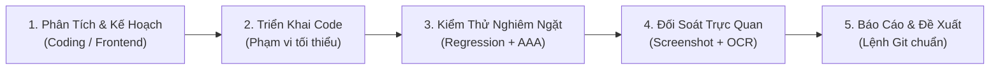

# AGENTS.md — Hệ Thống Quy Chuẩn Toàn Dự Án (Master Agent Protocol)

Tài liệu này là **Hiến pháp và Trung tâm Điều phối (Master Hub)** dành cho mọi AI Agent và Developer khi làm việc trên mã nguồn dự án **GardenEmpireGame**.
> **Tôn chỉ tối thượng:** Giữ vững toàn vẹn logic game Splendor; duy trì giao diện Deep Forest Glassmorphism cao cấp; kiểm thử bằng số liệu và đối soát thị giác thật; không tự ý commit ngầm khi chưa có yêu cầu.

---

## 1. Bản Đồ Phân Hệ & Các Agent Chuyên Trách

Hệ thống quy chuẩn dự án được mô đun hoá thành 4 quy chế chuyên biệt trong thư mục `.agents/`:

```
.agents/
├── AGENTS.md                         # [Tài liệu này] Hiến pháp chung & điều phối toàn dự án
├── coding/
│   └── coding_agents.md              # Quy chuẩn Lập trình Fullstack & Kiến trúc Game Engine
├── frontend/
│   └── frontend_designer.md          # Quy chuẩn Thiết kế UI/UX, Design Tokens & Glassmorphism
├── test/
│   └── test_agents.md                # Quy chuẩn Kiểm thử tự động, E2E & Chụp ảnh đối soát OCR
└── commit/
    └── commit_agents.md              # Quy chuẩn Git Commit, Conventional Commits & Scopes
```

### Bảng Điều Hướng & Trách Nhiệm Phân Hệ:

| Agent / Quy chế | File hướng dẫn chi tiết | Trọng tâm trách nhiệm |
| :--- | :--- | :--- |
| 💻 **Coding Agent** | [.agents/coding/coding_agents.md](file:///c:/University%20Coding%20Project/GardenEmpireGame/.agents/coding/coding_agents.md) | Kiến trúc Monorepo, Java 21 Spring Boot Backend, Vanilla JS Client, bảo toàn luật Splendor 15★, đồng bộ WebSocket State |
| 🎨 **Frontend Designer** | [.agents/frontend/frontend_designer.md](file:///c:/University%20Coding%20Project/GardenEmpireGame/.agents/frontend/frontend_designer.md) | Thẩm mỹ Deep Forest & Glassmorphism, 5 Botanical Energies + 1 WILD Gold, tích hợp skill `ui-ux-pro-max`, chuẩn trợ năng WCAG |
| 🧪 **Test Agent** | [.agents/test/test_agents.md](file:///c:/University%20Coding%20Project/GardenEmpireGame/.agents/test/test_agents.md) | Quy trình test 4 bước (AAA), kiểm tra hồi quy, test multi-tab WebSocket, chụp ảnh màn hình & OCR đối soát dữ liệu thật |
| 📦 **Commit Agent** | [.agents/commit/commit_agents.md](file:///c:/University%20Coding%20Project/GardenEmpireGame/.agents/commit/commit_agents.md) | Chuẩn Conventional Commits, Scopes dự án, quy tắc nâng phiên bản (Semantic Versioning: fix/UI `x.x.x+1`, feature lớn `x.x+1.0`), **chỉ xuất lệnh - không tự ý commit ngầm** |

---

## 2. Quy Trình Làm Việc Chuẩn (Master Workflow Pipeline)

Mọi tác vụ từ người dùng đều phải tuân thủ nghiêm ngặt chuỗi 5 giai đoạn sau:



1. **Giai đoạn 1: Tiếp nhận & Phân tích:**
   - Đọc kỹ yêu cầu và khảo sát các file liên quan trước khi sửa (`git status`, `git diff`).
   - Nếu là tác vụ UI/UX: Kích hoạt skill `ui-ux-pro-max` để tra cứu Design System và tuân thủ bảng màu token trong [frontend_designer.md](file:///c:/University%20Coding%20Project/GardenEmpireGame/.agents/frontend/frontend_designer.md).
2. **Giai đoạn 2: Triển khai mã nguồn:**
   - Sửa đổi nhỏ gọn, đúng trọng tâm, bảo toàn comment nghiệp vụ có sẵn theo [coding_agents.md](file:///c:/University%20Coding%20Project/GardenEmpireGame/.agents/coding/coding_agents.md).
3. **Giai đoạn 3: Kiểm thử tự động:**
   - Bắt buộc chạy kiểm thử hồi quy bảo vệ tính năng cũ.
   - Viết bài test mới phủ đủ các case (Happy Path, Biên Boundary, Ngoại lệ, Regression) theo [test_agents.md](file:///c:/University%20Coding%20Project/GardenEmpireGame/.agents/test/test_agents.md).
4. **Giai đoạn 4: Xác thực thị giác (Visual & OCR):**
   - Với mọi thay đổi trên bàn cờ hoặc giao diện: Bắt buộc chụp ảnh màn hình và chạy OCR quét chữ/số liệu thực tế để đối soát khớp 100% với game state.
5. **Giai đoạn 5: Báo cáo & Đề xuất commit:**
   - Xuất báo cáo kết quả kiểm thử chuẩn `## Kết quả kiểm thử`.
   - Viết ra khối lệnh `git add` và `git commit` chuẩn theo [commit_agents.md](file:///c:/University%20Coding%20Project/GardenEmpireGame/.agents/commit/commit_agents.md) để người dùng tự duyệt (không tự commit ngầm).

---

## 3. Các Nguyên Tắc Bất Di Bất Dịch (Core Commandments)

1. ❌ **Không sửa mã nghiệp vụ để lừa test pass:** Phát hiện bug phải báo cáo trung thực kèm chứng cứ.
2. ❌ **Không làm suy yếu bài test:** Cấm xoá test, cấm `@Disabled`, cấm `.skip`, cấm nới lỏng assertion.
3. ❌ **Chỉ báo PASS khi đã chạy thật:** Cấm bịa kết quả test hoặc đoán mò.
4. 🔒 **Chỉ gửi lệnh commit:** Tuyệt đối không tự ý chạy `git commit` hay `git push` ngầm khi người dùng chưa yêu cầu rõ ràng.
5. 🛡️ **Bảo vệ toàn vẹn logic game:** Tuân thủ nguyên bản 100% luật Splendor (15★, max 10 token, max 3 thẻ giữ chỗ, quy tắc lấy 3 token khác màu hoặc 2 token cùng màu).

---

## 4. Bảng Lệnh Tra Cứu Nhanh Cho Dự Án GardenEmpireGame

### 4.1. Phân hệ Backend Java (`server/`)
| Mục đích | Lệnh thực thi | Ghi chú |
| :--- | :--- | :--- |
| **Biên dịch test** | `mvn test-compile` | Chạy tại thư mục `server/` |
| **Chạy toàn bộ unit tests** | `mvn test` | 28 test cases bảo vệ GameEngine & Room |
| **Test GameEngine lõi** | `mvn test -Dtest=GameEngineTest` | Kiểm tra luật mua cây, tính điểm, lượt đi |
| **Test RoomService** | `mvn test -Dtest=RoomServiceTest` | Kiểm tra tạo phòng, vào phòng, thoát phòng |
| **Khởi động Backend Dev** | `mvn spring-boot:run` | Server chạy tại cổng `8080` (`ws://localhost:8080/ws/game`) |

### 4.2. Phân hệ Frontend & Kịch bản Kiểm Thử (`client/` & `tests/`)
| Mục đích | Lệnh thực thi | Ghi chú |
| :--- | :--- | :--- |
| **Test Player Box UI** | `node tests/test_player_box_ui.js` | 46 tests hiển thị 5 phân khu và 6 loại token |
| **Test Chat Toggle UI** | `node tests/test_chat_toggle_ui.js` | 10 tests thu gọn/mở rộng chat và class `.hidden` |
| **Test 3 Recent Logs UI** | `node tests/test_game_log_toggle_3_recent.js` | Kiểm tra hiển thị 3 log gần nhất và modal lịch sử |
| **Test Chat Realtime E2E** | `node tests/test_in_game_chat_e2e.js` | Test đồng bộ WebSocket đa tab, chống spam, khử XSS |
| **Test Endgame Announcement** | `node tests/test_endgame_announcement_ui.js` | 15 tests pop-up vinh danh và đếm ngược 20s |
| **Mở Client kiểm thử** | Dùng Live Server mở `client/index.html` hoặc `npx serve client -l 3000` | Mở giao diện tại cổng `3000` |
