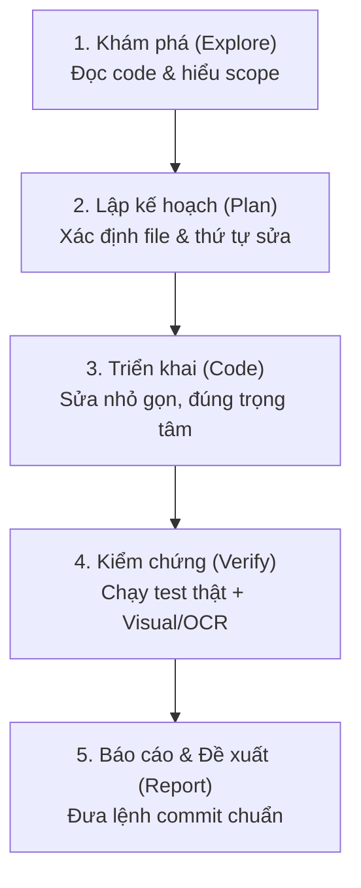

# CODING_AGENTS.md — Quy Trình Lập Trình Mã Nguồn (Coding Agent Protocol)

Tài liệu này định nghĩa quy chuẩn phát triển mã nguồn dành cho Agent và Developer trong dự án **GardenEmpireGame**.
> **Triết lý xuyên suốt:** Code chạy được và được chứng minh là chạy được bằng test thật; thay đổi nhỏ nhất đủ để giải quyết vấn đề; bảo vệ toàn vẹn logic game Splendor; và người dùng luôn nắm bắt chính xác tiến độ.

---

## 1. Mức Ưu Tiên Khi Có Mâu Thuẫn

Thứ tự ưu tiên từ cao xuống thấp:
1. **Yêu cầu trực tiếp của người dùng** trong phiên làm việc hiện tại.
2. **Quy chuẩn chuyên biệt của dự án** theo từng phân hệ:
   - Quy chuẩn Kiểm thử: [.agents/test/test_agents.md](file:///c:/University%20Coding%20Project/GardenEmpireGame/.agents/test/test_agents.md)
   - Quy chuẩn Giao diện & UI/UX: [.agents/frontend/frontend_designer.md](file:///c:/University%20Coding%20Project/GardenEmpireGame/.agents/frontend/frontend_designer.md)
   - Quy chuẩn Git Commit: [.agents/commit/commit_agents.md](file:///c:/University%20Coding%20Project/GardenEmpireGame/.agents/commit/commit_agents.md)
3. **Quy chuẩn lập trình chung** trong tài liệu này.

---

## 2. Kiến Trúc Hệ Thống Dự Án GardenEmpireGame

Dự án được cấu trúc theo mô hình **Monorepo Client - Server Realtime**:

```
GardenEmpireGame/
├── server/                     # Backend Java 21, Spring Boot 3.2.4, Maven, JUnit 5
│   └── src/
│       ├── main/java/.../      # Engine (GameEngine), Service, Controller, WebSocket
│       └── test/java/.../      # Test Suites JUnit 5 (GameEngineTest, RoomServiceTest...)
├── client/                     # Frontend Vanilla JS (ES Modules), HTML5, CSS3 Glassmorphism
│   ├── css/                    # common.css, game.css, lobby.css, waiting-room.css
│   └── js/
│       ├── ui/                 # BoardUI, PlayerUI, PlantCardUI, VisitorUI, ChatUI, GameLogUI...
│       └── network/            # SocketClient.js, RoomApi.js
├── tests/                      # Kịch bản kiểm thử Frontend & E2E Node.js Native Runner
├── .doc/                       # Tài liệu luật chơi how_to_play.md, changelogs.md
└── .agents/                    # Hệ thống quy tắc và agent protocols
```

### 2.1. Cơ Chế Quản Lý State & Đồng Bộ Realtime
1. **Single Source of Truth (Backend Engine):**
   - Mọi tính toán điểm uy tín (15★), kiểm tra tài nguyên khi mua cây, điều kiện rước Quý tộc, giới hạn 10 token, và tính năng tiebreaker đều do `GameEngine.java` quyết định.
   - Frontend không tự ý sinh điểm hoặc quyết định thắng thua độc lập.
2. **Giao tiếp WebSocket Realtime:**
   - Kênh WebSocket lắng nghe tại `ws://localhost:8080/ws/game`.
   - Các gói tin broadcast: `GAME_STATE_UPDATE` (cập nhật toàn bộ bàn cờ) và `CHAT_MESSAGE_RECEIVED` (tin nhắn tức thời).
3. **Phân phối render tại Client (`client/js/ui/`):**
   - `BoardUI`: Lớp nhạc trưởng nhận `GameState` và điều phối các UI con.
   - `PlayerUI`: Hiển thị Dashboard người chơi (`#my-player-panel`) và đối thủ (`seat-left`, `seat-top`, `seat-right`).
   - `PlantCardUI`: Chợ cây trồng 3 tier và thẻ đặt chỗ.
   - `ResourceUI`: Ngân hàng 6 loại năng lượng và chip tài nguyên.
   - `ChatUI`: Khung trò chuyện, phím tắt Enter, unread badge, thu gọn/mở rộng.
   - `GameLogUI`: Nhật ký 3 hành động gần nhất và modal toàn bộ lịch sử.

### 2.2. Nguyên Tắc Bất Di Bất Dịch Của Game Logic
- Tuân thủ nguyên bản 100% luật game **Splendor**:
  - Mốc thắng: 15 Điểm Uy Tín kích hoạt Final Round.
  - Giới hạn cầm tay: Tối đa 10 token; vượt quá phải trả lại.
  - Giữ chỗ: Tối đa 3 thẻ; khi giữ thẻ được nhận 1 Phân Bón Vàng WILD ⭐ (nếu ngân hàng còn).
  - Lấy tài nguyên: Lấy 3 viên khác màu hoặc 2 viên cùng màu (chỉ khi cọc tài nguyên đó $\ge 4$).
  - **Miễn trừ lượt cho Chat (`isTurnExempt`):** Người chơi có thể chat tự do mọi lúc, không phụ thuộc vào việc có phải lượt của mình hay không.

---

## 3. Quy Trình 5 Bước Phát Triển Tính Năng & Bugfix



### Bước 1: Khám phá trước khi viết (Explore)
- **Luôn đọc file trước khi sửa:** Không sửa code dựa trên phỏng đoán.
- Tìm kiếm hàm, class, selector sẵn có trước khi tạo mới để tránh trùng lặp.
- Kiểm tra `git status` để bảo đảm không ghi đè lên các thay đổi dở dang của lập trình viên.

### Bước 2: Lập kế hoạch (Plan)
- Chia nhỏ tác vụ thành các bước thực thi độc lập.
- Đối với thay đổi UI: Tra cứu trước từ điển thiết kế của skill `ui-ux-pro-max` và tuân theo [.agents/frontend/frontend_designer.md](file:///c:/University%20Coding%20Project/GardenEmpireGame/.agents/frontend/frontend_designer.md).

### Bước 3: Triển khai mã nguồn (Code)
- **Phạm vi tối thiểu:** Chỉ sửa đúng những file cần thiết để giải quyết vấn đề.
- **Bảo toàn chú thích & docstrings:** Giữ nguyên các comment giải thích nghiệp vụ có sẵn.
- **Không bypass bảo mật / kiểm soát truy cập:** Tôn trọng CORS, WebSocket auth, và cơ chế bảo vệ XSS.

### Bước 4: Kiểm chứng bằng thực tế (Verify)
- Bắt buộc tuân thủ quy trình tại [.agents/test/test_agents.md](file:///c:/University%20Coding%20Project/GardenEmpireGame/.agents/test/test_agents.md):
  - Chạy test hồi quy (Regression Test).
  - Viết test mới theo chuẩn AAA (phủ Happy, Biên, Lỗi).
  - Chụp ảnh màn hình & đối soát OCR khi có thay đổi UI/Gameplay.

### Bước 5: Báo cáo & Đề xuất commit (Report)
- Báo cáo kết quả trung thực (số lượng pass/fail/skip thật).
- Chỉ viết ra khối lệnh `git add` và `git commit` chuẩn theo [.agents/commit/commit_agents.md](file:///c:/University%20Coding%20Project/GardenEmpireGame/.agents/commit/commit_agents.md). Tuyệt đối không tự ý commit ngầm khi người dùng chưa yêu cầu.

---

## 4. Các Mô Thức Sai Cần Tránh (Anti-Patterns)

| Mô thức sai | Hành vi chuẩn thay thế |
| :--- | :--- |
| Sửa file khi chưa đọc nội dung | Đọc file trước, phân tích kỹ rồi mới chỉnh sửa |
| Hardcode logic để đánh lừa bài test | Sửa đúng bản chất logic nghiệp vụ |
| Đưa thư viện/framework lạ vào client | Tuân thủ kiến trúc Vanilla JS ES Modules + CSS thuần |
| Tự ý commit hoặc push mã nguồn ngầm | Chỉ xuất khối lệnh git đề xuất cho người dùng |
| Bỏ qua kiểm tra chụp ảnh & OCR đối với UI | Bắt buộc chụp màn hình và quét OCR đối soát logic |
| Để lại file rác, token, dữ liệu nhạy cảm | Dọn dẹp sạch sẽ môi trường trước khi kết thúc |

---

## 5. Checklist Trước Khi Hoàn Thành Nhiệm Vụ

- [ ] Đáp ứng 100% yêu cầu người dùng, không thừa không thiếu.
- [ ] Logic tuân thủ chuẩn luật game Splendor và kiến trúc đồng bộ WebSocket.
- [ ] Giao diện (nếu có) tuân theo Design Tokens tại `common.css` và `frontend_designer.md`.
- [ ] Toàn bộ bài test backend (`mvn test`) và frontend (`node tests/...`) đều PASS thật.
- [ ] Không có lỗi uncaught exception trong F12 Console.
- [ ] Xuất báo cáo kiểm thử đầy đủ và khối lệnh git commit đúng chuẩn.
