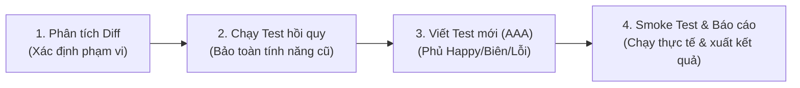

# TEST_AGENTS.md — Quy Chuẩn Kiểm Thử Mã Nguồn (Test Agent Protocol)

Tài liệu này là quy chuẩn thực chiến dành cho Agent AI và Developer khi **kiểm thử mã nguồn dự án GardenEmpireGame**.
> **Mục tiêu tối thượng:** Tìm ra lỗi thật, bảo vệ toàn vẹn logic game Splendor, không hợp thức hoá test xanh bằng mọi giá.

---

## 1. Nguyên Tắc Cốt Lõi (Bất Di Bất Dịch)

1. **Không sửa mã nghiệp vụ để lừa test pass:** Phát hiện bug thì báo cáo kèm chứng cứ (file, dòng, stack trace); chỉ sửa khi được yêu cầu rõ ràng.
2. **Không làm suy yếu bài test:** Tuyệt đối không xoá test, không dùng `@Disabled`, `.skip`, không nới lỏng assertions, không mock tràn lan khiến test mất ý nghĩa thực tế.
3. **Chỉ báo PASS khi đã chạy thật:** Nêu số liệu thật (pass/fail/skip), không bịa kết quả.
4. **Tính tất định (Deterministic):** Kết quả test không được phụ thuộc vào thời gian thực, mạng ngoài hoặc thứ tự chạy. Dữ liệu ngẫu nhiên (nếu có) phải cố định seed.
5. **Phạm vi can thiệp tối thiểu:** Ưu tiên chỉ thêm/sửa file test, không chỉnh sửa file cấu hình dự án trừ khi bắt buộc.
6. **Xác thực trực quan bằng Chụp ảnh & OCR:** Khi kiểm thử các thay đổi liên quan đến UI hoặc bàn cờ, không chỉ dựa vào cấu trúc DOM giả lập hay log ngầm. Bắt buộc phải **chụp ảnh màn hình (Screenshot)** và chạy **OCR (Optical Character Recognition) / Vision** để đối soát dữ liệu hiển thị thực tế (chữ, số điểm, số token, nhãn, icon) có khớp 100% với state logic hay không.

---

## 2. Quy Trình Kiểm Thử 4 Bước Tinh Gọn



### Bước 1: Xác định phạm vi ảnh hưởng
- Chạy `git status`, `git diff` để kiểm tra các file, class, method hoặc UI component vừa thay đổi.
- Nhận diện phân hệ bị tác động:
  - Backend Engine: `server/` (Java / Spring Boot).
  - Client UI/Logic: `client/` (HTML5, CSS3, Vanilla JS ES Modules).
  - Kịch bản kiểm thử: `tests/` (Node.js test runner).

### Bước 2: Chạy kiểm thử hồi quy (Regression Test)
- Chạy ngay test suite của module vừa sửa để phát hiện sớm lỗi phá vỡ logic cũ.
- Nếu test fail: Kiểm tra xem lỗi do code mới hay đã tồn tại từ trước (chạy lại trên nhánh sạch bằng `git stash`).

### Bước 3: Viết bài test mới (Chuẩn Arrange – Act – Assert)
Mọi tính năng/bugfix mới bắt buộc phải có test phủ các trường hợp:

| Loại Case | Trọng tâm kiểm thử | Ví dụ thực tế trong GardenEmpire |
| :--- | :--- | :--- |
| **Happy Path** | Dữ liệu hợp lệ, kết quả trả về chuẩn | Mua cây đủ tài nguyên, nhận điểm và token tương ứng |
| **Biên (Boundary)** | Giá trị $0$, $1$, cực đại, rỗng, null | Người chơi mới vào (0 token, 0 điểm); đạt tối đa 3 thẻ giữ chỗ; vượt quá 10 token |
| **Ngoại lệ & Vi phạm** | Thiếu tài nguyên, sai lượt, trạng thái sai | Đi không phải lượt, mua thẻ khi thiếu tài nguyên, giữ thẻ khi đã full 3 |
| **Regression (Tái hiện bug)** | Test mô phỏng đúng bug vừa sửa | **Phải FAIL trước khi sửa code, PASS sau khi sửa code** |
| **Đồng bộ WebSocket / Đa tab** | Giao tiếp realtime nhiều người chơi | Chat không phụ thuộc lượt, sync trạng thái phòng tức thời |

### Bước 4: Kiểm tra thực tế (Smoke / E2E), Chụp ảnh & OCR
- Khởi động dev server backend & client, thử nghiệm thao tác phòng/game thật.
- Kiểm tra console browser (F12) không có lỗi uncaught exception hoặc warning lạ.
- **Chụp ảnh màn hình & OCR đối soát trực quan (Bắt buộc cho UI / Gameplay):**
  - Chụp ảnh màn hình thực tế (dùng headless browser/screenshot script).
  - Trích xuất chữ và số liệu bằng OCR/Vision để xác minh: điểm số, số token từng loại, nhãn cảnh báo, tên người chơi, trạng thái lượt.
  - Đảm bảo dữ liệu trích xuất từ ảnh khớp hoàn toàn với state nội bộ; không bị vỡ layout, tràn chữ (overflow), che khuất hoặc CSS ẩn.
- Chạy lại toàn bộ test một lần nữa để loại trừ **Flaky test** (chạy 3–5 lần nếu có dấu hiệu chập chờn).
- Tắt các server dev nền, dọn dẹp file tạm, kiểm tra `git status` trước khi kết thúc.

---

## 3. Quy Trình Xử Lý Sự Cố Khi Test Fail

1. **Đọc kỹ stack trace:** Xác định chính xác class, dòng code và nguyên nhân ném lỗi.
2. **Phân loại nguyên nhân:**
   - **Bug mã mới:** Tạo báo cáo lỗi chi tiết kèm đề xuất phương án xử lý.
   - **Test cũ lỗi thời:** Do quy tắc game thay đổi có chủ đích $\rightarrow$ cập nhật lại test và giải thích rõ ràng.
   - **Lỗi môi trường / CSDL:** Thiếu biến môi trường, chưa bật service phụ thuộc.
   - **Flaky test:** Do độ trễ bất đồng bộ (timing/race condition) $\rightarrow$ sửa cơ chế chờ (await/polling) thay vì sleep tĩnh.
3. **Giới hạn 3 lần thử:** Nếu sửa 3 lần không qua, dừng lại và báo cáo trung thực hiện trạng, không đoán mò.

---

## 4. Những Điều TUYỆT ĐỐI CẤM

- ❌ **Cấm báo PASS khi chưa chạy câu lệnh thực tế.**
- ❌ **Cấm xoá, comment hoặc skip test fail** để cho xong việc.
- ❌ **Cấm sửa assertion để khớp với kết quả sai** của logic lỗi.
- ❌ **Cấm hardcode kết quả mong đợi** vào code nghiệp vụ để qua mặt unit test.
- ❌ **Cấm commit thông tin bí mật**, token, mật khẩu vào repo hoặc file test.
- ❌ **Cấm tự ý nâng/hạ phiên bản thư viện** trong `pom.xml` làm phá vỡ dependency tree.

---

## 5. Mẫu Báo Cáo Kiểm Thử Chuẩn Bắt Buộc

Khi kết thúc mỗi phiên làm việc, Test Agent phải xuất báo cáo theo mẫu sau:

```markdown
## Kết quả kiểm thử

**Phạm vi kiểm tra:** <Module / Class / Component / Endpoint>
**Kết luận:** ✅ ĐẠT | ⚠️ ĐẠT CÓ LƯU Ý | ❌ KHÔNG ĐẠT

### Đã chạy
| Phân hệ / Hạng mục | Lệnh thực thi | Kết quả |
|---|---|---|
| Backend Unit Test | `mvn test -Dtest=GameEngineTest` | ✅ 26 pass / 0 fail |
| Frontend UI Test | `node tests/test_player_box_ui.js` | ✅ 46 pass / 0 fail |
| Smoke Test | Mở trình duyệt kết nối room WebSocket | ✅ Ổn định |
| Visual & OCR Verification | Chụp ảnh màn hình & OCR đối soát dữ liệu | ✅ Khớp 100% với Game State |

### Bằng chứng hình ảnh & OCR (Visual Verification)
- **File ảnh chụp:** `tests/screenshots/<tên_ảnh>.png`
- **Kết quả OCR trích xuất:** `<Dữ liệu text/số liệu nhận diện được>` $\rightarrow$ Đối chiếu state: ✅ Trùng khớp

### Test đã thêm / chỉnh sửa
- `tests/xxx.js`: <Mô tả tóm tắt các case test mới>

### Lỗi / Vấn đề phát hiện (nếu có)
1. **[Mức độ: Cao/Trung/Thấp]** <Mô tả lỗi> — Vị trí: `file:dòng` — Cách tái hiện: <bước>

### Chưa kiểm tra được & Lý do
- <Ví dụ: Chưa có kịch bản test chịu tải 100 phòng đồng thời...>

### Đề xuất tiếp theo
- <Hành động khuyến nghị cho lập trình viên>
```

---

## 6. Bộ Lệnh Kiểm Thử Thực Tế Cho Dự Án GardenEmpireGame

### 6.1. Phân hệ Backend (`server/`)
- **Môi trường & Công nghệ:** Java 21 (OpenJDK 21), Spring Boot 3.2.4, Spring WebSocket STOMP, JUnit 5, Maven 3.9+.
- **Thư mục làm việc:** `server/`

| Thao tác | Câu lệnh thực thi (tại thư mục `server/`) | Ghi chú |
| :--- | :--- | :--- |
| **Biên dịch Test** | `mvn test-compile` | Đảm bảo mã nguồn và test classes biên dịch sạch sẽ |
| **Chạy toàn bộ test** | `mvn test` | Chạy toàn bộ test suite JUnit 5 của backend (28 tests) |
| **Test Game Engine lõi** | `mvn test -Dtest=GameEngineTest` | Kiểm tra logic tính điểm, tài nguyên, lượt chơi (26 tests) |
| **Test Quản lý phòng** | `mvn test -Dtest=RoomServiceTest` | Kiểm tra tạo phòng, vào phòng, thoát phòng (4 tests) |
| **Test Luồng tích hợp** | `mvn test -Dtest=MultiPlayerGameFlowIntegrationTest` | Luồng chơi đa người qua API/WebSocket |
| **Chạy 1 method test cụ thể** | `mvn test -Dtest=GameEngineTest#tenMethodCanTest` | Nhắm trực tiếp vào 1 ca kiểm thử để debug nhanh |
| **Đóng gói sản phẩm** | `mvn clean package -DskipTests` | Tạo file `.jar` hoàn chỉnh |
| **Khởi động Backend Dev** | `mvn spring-boot:run` | Server lắng nghe tại cổng `8080` |

### 6.2. Phân hệ Frontend & Kịch bản E2E (`client/` & `tests/`)
- **Môi trường & Công nghệ:** Vanilla JS (ES Modules), HTML5, CSS3, WebSocket API.
- **Test Runner:** Node.js Native Runner.
- **Thư mục làm việc:** Thư mục gốc dự án (`GardenEmpireGame`)

| Thao tác | Câu lệnh thực thi (tại thư mục gốc) | Ghi chú |
| :--- | :--- | :--- |
| **Test Player Box UI** | `node tests/test_player_box_ui.js` | Test giao diện hiển thị 5 phân khu, 6 loại token, bàn 2-4 người (46 tests) |
| **Test Chat Toggle UI** | `node tests/test_chat_toggle_ui.js` | Test nút thu gọn/mở rộng, class `.hidden`, aria attributes (10 tests) |
| **Test 3 Recent Logs UI** | `node tests/test_game_log_toggle_3_recent.js` | Test hiển thị 3 log gần nhất và modal lịch sử |
| **Test Chat Trực tuyến E2E** | `node tests/test_in_game_chat_e2e.js` | Test chống spam, lọc XSS, sync chat WebSocket đa tab |
| **Test Action Logs E2E** | `node tests/test_game_action_logs_e2e.js` | Test đồng bộ nhật ký hành động toàn ván chơi |
| **Test Endgame Announcement** | `node tests/test_endgame_announcement_ui.js` | Test pop-up vinh danh, đếm ngược tự động 20s (15 tests) |
| **Test Đa tab (Multi-tab)** | `node tests/test_multi_tab.js` | Test phiên chơi đồng thời trên nhiều cửa sổ |
| **Mở Client kiểm thử** | Dùng Live Server mở `client/index.html` hoặc `npx serve client -l 3000` | Giao diện web chạy tại cổng `3000` |

---

## 7. Checklist Kiểm Tra Thực Tế (Smoke Test Checklist)

Trước khi xác nhận hoàn thành một tính năng UI hoặc Gameplay, thực hiện lần lượt:
1. **Khởi động Backend:** Chạy `cd server; mvn spring-boot:run` $\rightarrow$ Đảm bảo cổng `8080` sẵn sàng.
2. **Khởi động Client:** Mở giao diện `client/index.html` hoặc `client/game.html` trên trình duyệt.
3. **Kiểm tra WebSocket:** Mở F12 Tab Console/Network $\rightarrow$ Xác nhận kết nối tới `ws://localhost:8080/ws/game` thành công (`101 Switching Protocols`).
4. **Kiểm tra Đa người chơi (2 Tab):**
   - Tab 1: Tạo phòng, đóng vai Host.
   - Tab 2: Vào phòng bằng Room Code.
   - Xác nhận: Danh sách người chơi và trạng thái phòng được cập nhật tức thời trên cả hai tab.
5. **Kiểm tra Chat & Log:** Gửi tin nhắn chat, thực hiện hành động trồng cây $\rightarrow$ đảm bảo tin nhắn hiển thị tức thì, không giật lag và không có lỗi JS đỏ trong Console.
6. **Chụp ảnh màn hình & Xác minh OCR (Visual & OCR Verification):**
   - **Chụp ảnh:** Chụp lại toàn bộ bàn cờ hoặc phân khu vừa thay đổi (Player Box, Bảng thẻ cây, Modal lịch sử, Khung chat).
   - **Chạy OCR / Vision:** Quét ảnh để nhận dạng tất cả chuỗi văn bản và số liệu hiển thị thực tế (điểm số, số lượng từng loại token, nhãn `chip-empty`, cảnh báo token > 10, vương miện host 👑).
   - **Đối soát tính toàn vẹn:** Dữ liệu OCR trích xuất từ ảnh chụp **bắt buộc phải khớp 100%** với dữ liệu trong `gameState` / DOM (đảm bảo không bị lỗi css `display: none`, tràn dòng `overflow: hidden`, bị đè z-index hoặc hiển thị sai lệch).
