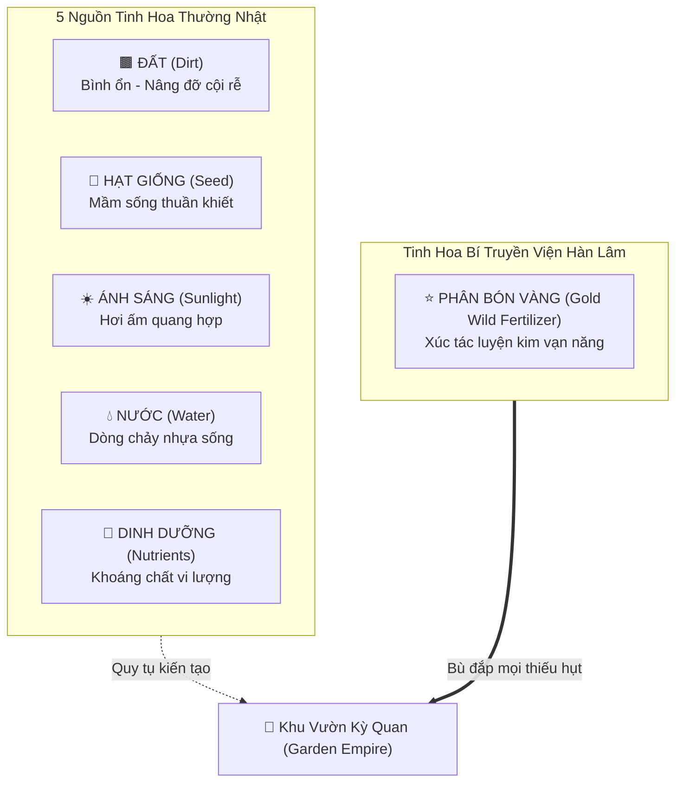
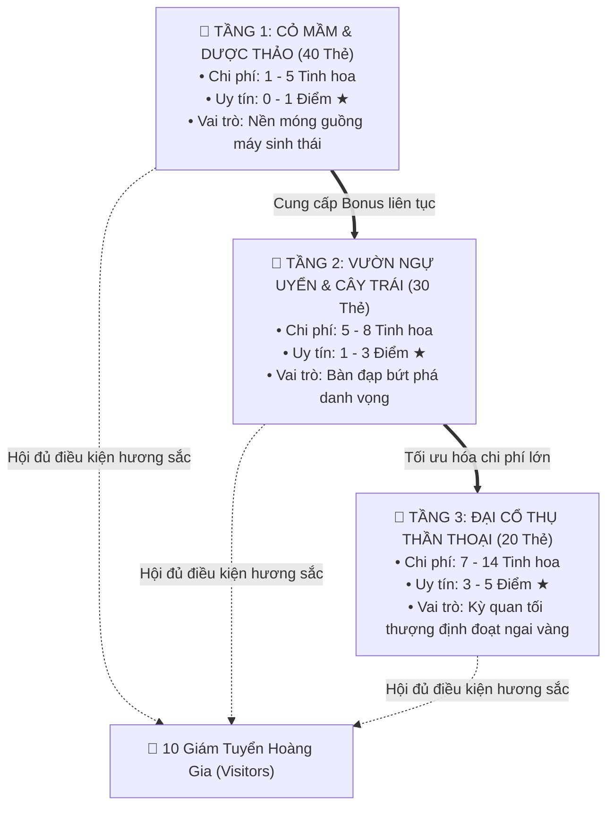

# 📜 BIÊN NIÊN SỬ FLORA VALLEY: KỶ NGUYÊN KHAI SÁNG VÀ ĐẾ CHẾ SINH THÁI
### *The Chronicles of Flora Valley: The Botanical Renaissance & The Living Empire*

> *"Từ một hạt giống ngủ vùi trong lòng đất lạnh, đến khi vươn mình thành đại thụ che mát cả bầu trời — đó không chỉ là sự sinh trưởng, mà là cả một cuộc viễn chinh của ý chí, tri thức và nghệ thuật."*  
> — **Trích Nhật Ký Nghiên Cứu của Viện Hàn Lâm Thảo Mộc Hoàng Gia Flora**

---

## 🧭 LỜI TỰA: THỜI ĐẠI CỦA CÁC BẬC THẦY LÀM VƯỜN

Vào thế kỷ thứ 16 của lục địa Aethelgard, khi những cuộc chiến giành đoạt quặng mỏ và kim loại quý dần lùi vào dĩ vãng, một phong trào tư tưởng và nghệ thuật mới bùng nổ: **Kỷ Nguyên Khai Sáng Thực Vật Học (The Botanical Renaissance)**. Con người nhận ra rằng sự giàu có tột cùng của nhân loại không nằm ở những khối đá lạnh lẽo hay vàng thoi vô tri, mà ẩn giấu trong hơi thở của đất mẹ, trong sự tuần hoàn kỳ diệu của mầm sống và bản hòa ca của muôn loài thảo mộc.

Tại trung tâm của lục địa, nằm nép mình giữa những rặng núi sương mờ và dòng sông ngọc bích, là **Flora Valley** (Thung Lũng Flora) — một thánh địa sinh thái màu mỡ nơi giao thoa của các mạch năng lượng nguyên sinh cổ xưa.

Ở nơi đây, hàng năm, **Viện Hàn Lâm Thảo Mộc Hoàng Gia** mở hội tuyển chọn những tài năng xuất chúng nhất khắp bốn phương. Bạn — một **Master Gardener** (Bậc Thầy Làm Vườn) đầy hoài bão — đặt chân đến thung lũng với chiếc giỏ đan đơn sơ, một cuốn sổ tay ký họa bằng da thuộc (*Botanical Codex*) và khát vọng cháy bỏng: biến một mảnh đất hoang vu thành một **Garden Empire** (Đế Chế Vườn Sinh Thái) trác tuyệt, thu hút sự viếng thăm của các linh thú tri thức và bước lên đỉnh cao vinh quang của giới học thuật thế giới.

---

## 🏞️ CHƯƠNG I: THÁNH ĐỊA FLORA VALLEY VÀ LỤC ĐẠI TINH HOA NĂNG LƯỢNG

Thung lũng Flora Valley không phải là một mảnh đất bình thường. Dưới lòng thung lũng là tàn tích của *Khu Vườn Địa Đàng Thượng Cổ*, nơi năng lượng của tự nhiên cô đọng thành 6 dạng vật chất hữu hình được gọi là **Tinh Hoa Năng Lượng (Elemental Essences / Tokens)**:



### 1. 🟫 Đất Màu Mỡ (Dirt Essence)
Lớp đất mùn basalt nâu sẫm lắng đọng qua hàng thiên niên kỷ từ chân núi lửa cổ. Đất giữ ấm cho hạt, neo chặt rễ cái và lưu giữ ký ức của rừng già. Trong tay người làm vườn, Đất đại diện cho sự kiên định và gốc rễ vững bền.

### 2. 🌰 Hạt Giống Thuần Khiết (Seed Essence)
Những viên ngọc sống tí hon được bao bọc trong lớp vỏ bóng bẩy như ngà voi. Mỗi hạt giống mang trong mình mật mã di truyền kỳ diệu của đất trời, chờ đợi giọt nước đầu tiên để thức giấc và khai mở tiềm năng vô hạn.

### 3. ☀️ Ánh Sáng Rực Rỡ (Sunlight Essence)
Những tia nắng vàng óng ả rót xuống từ Đèo Thiên Đỉnh, được các thấu kính pha lê của Viện Hàn Lâm hội tụ thành những tinh thể ấm áp. Ánh sáng thúc đẩy quá trình quang hợp diệu kỳ, nhuộm sắc cho cánh hoa và sưởi ấm những chiếc lá non.

### 4. 💧 Nước Suối Thanh Khiết (Water Essence)
Dòng nước băng tan từ đỉnh tuyết sơn ngấm qua bảy tầng thạch anh tím, mang theo sự mát lành và sinh khí mãnh liệt. Nước là người vận chuyển cần mẫn, đưa nhựa sống đi khắp các mao mạch của thân cây.

### 5. 🧪 Tinh Chất Dinh Dưỡng (Nutrient Essence)
Hỗn hợp khoáng chất vi lượng màu xanh ngọc bích được các nhà giả kim thiên nhiên chưng cất từ rêu cổ, vỏ cây thơm và lá mục hữu cơ. Dinh dưỡng là liều thuốc tăng trưởng diệu kỳ, kích thích cây đâm chồi nảy lộc thần tốc.

### 6. ⭐ Hổ Phách Phân Bón Vàng (Gold Wild Fertilizer)
Chất xúc tác giả kim huyền thoại do chính các Đại Học Sĩ Viện Hàn Lâm sáng tạo. Thứ bột vàng óng ánh như bụi sao này có đặc tính biến ảo khôn lường: nó có thể thay thế cho bất kỳ dòng tinh hoa nào (Đất, Hạt, Nắng, Nước, Dinh Dưỡng). Tuy nhiên, Phân Bón Vàng cực kỳ quý hiếm (luôn chỉ có đúng **5 lọ** được lưu hành trong viện bảo mật). Một Master Gardener chỉ được Viện Hàn Lâm trao tặng 1 lọ Phân Bón Vàng khi họ thực hiện nghi thức **Đặt Chỗ Nghiên Cứu Kín (Reserve)** cho một giống cây tương lai.

---

## 🧑‍🌾 CHƯƠNG II: SỨ MỆNH MASTER GARDENER — KHỞI ĐẦU KHIÊM TỐN

Khi một Master Gardener bước vào cuộc so tài tại Flora Valley, họ đối mặt với một thực tế khắc nghiệt:
- **Túi trữ tài nguyên hữu hạn:** Chiếc túi da thuộc của mỗi nghệ nhân chỉ có sức chứa tối đa **10 viên Tinh Hoa** cùng lúc. Bất kỳ sự tham lam thu gom quá đà nào cũng sẽ khiến tinh hoa bị phân rã, buộc người làm vườn phải trả bớt lại cho thung lũng.
- **Mảnh đất ban đầu trống trải:** Không có bất kỳ bóng mát hay sự che chở nào; mọi thứ phải được gieo trồng từ số không.
- **Sức ép từ các đồng nghiệp xuất chúng:** Có từ 2 đến 4 Master Gardeners cùng chia sẻ một thung lũng. Tài nguyên trong ngân hàng có hạn, những hạt giống quý trên thị trường thì ai cũng thèm muốn.

Mỗi lượt bước đi trong thung lũng đòi hỏi một quyết định chiến lược cân não:
1. **Thu thập tinh hoa:** Lấy 3 loại tinh hoa khác màu nhau để đa dạng hóa dinh dưỡng, hoặc kiên nhẫn tích lũy 2 viên cùng loại khi nguồn cung của thung lũng dồi dào (ngân hàng còn $\ge 4$ viên).
2. **Ươm trồng thực vật:** Đưa một giống cây từ Chợ Thảo Mộc hoặc từ bản thảo đặt chỗ trên tay xuống đất vườn, thanh toán chi phí nguyên tố và kích hoạt sức mạnh sinh thái.
3. **Nghiên cứu & Đặt chỗ bí mật:** Đánh dấu chủ quyền lên một giống cây quý (giấu kín tối đa 3 bản thảo) trước khi đối thủ kịp chạm tay vào, đồng thời nhận về một lọ Phân Bón Vàng ⭐ đầy quyền năng.

---

## 🌲 CHƯƠNG III: TAM TẦNG THẢO MỘC — 90 KỲ HOA DỊ THẢO

Hệ thực vật của Flora Valley được chia làm 3 tầng sinh quyển nghiêm ngặt theo chuẩn phân loại học Linnaeus của thời kỳ Phục Hưng:



### 1. 🌱 Tầng 1: Cỏ Mầm & Thảo Mộc Khởi Nguyên (40 Giống Cây)
Những sinh linh nhỏ bé nhưng mang sức sống mãnh liệt. Chúng mọc sát mặt đất mùn, sinh trưởng nhanh như gió:
- *Dòng Đất:* Cỏ Ba Lá may mắn, Cây Sen Đá bền bỉ, Lưỡi Hổ kiên cường, Củ Cải Đỏ giấu mình dưới bùn sâu.
- *Dòng Hạt Giống:* Cây Mè Đen thơm bùi, Đậu Hà Lan trĩu quả, Đậu Phộng béo ngậy, Lúa Mạch óng ánh như vàng ròng.
- *Dòng Nắng:* Mầm Hướng Dương luôn ngước nhìn thái dương, Hoa Giấy bừng sắc rực lửa, Cây Ớt Chỉ Thiên cay nồng nhiệt huyết.
- *Dòng Nước:* Rau Mồng Tơi mướt mát, Cây Trầu Bà leo bám rặng đá, Bèo Hoa Dâu lọc trong dòng kênh, Thủy Trúc vươn cao đón sương.
- *Dòng Dinh Dưỡng:* Nấm Rơm nảy mầm sau cơn mưa, Rau Bạc Hà thơm ngát sảng khoái, Dâu Tây đỏ mọng, Nha Đam mọng nước thanh lọc đất đai.

*Ý nghĩa chiến lược:* Dù hiếm khi mang lại Điểm Uy Tín (chỉ 0-1★), nhưng Tầng 1 chính là **trái tim của cỗ máy sinh thái**. Mỗi mầm non đơm hoa sẽ cung cấp một dòng năng lượng vĩnh viễn (Bonus), giúp người làm vườn cắt giảm chi phí cho tất cả các thế hệ cây trồng tương lai!

### 2. 🌿 Tầng 2: Vườn Ngự Uyển & Hoa Trái Thượng Uyển (30 Giống Cây)
Khi đất đai đã màu mỡ và các luống mầm đã bén rễ, khu vườn bắt đầu đón chào những bụi cây cảnh kiêu sa và những cây ăn trái trĩu cành:
- *Cây ăn trái:* Cam Sành thơm ngọt, Xoài Cát Hoàng Gia, Bưởi Da Xanh trứ danh, Chanh Đào thanh khiết, Nhãn Lồng ngọt ngào.
- *Sắc hoa rực rỡ:* Hoa Tulip quý phái từ phương xa, Hoa Sen Trắng tinh khôi trên mặt hồ tĩnh lặng, Cúc Họa Mi trong trẻo, Mai Vàng và Đào Thắm báo hiệu mùa lễ hội, Hoa Hồng Nhung nhung gấm của các bậc quyền quý.
- *Gỗ thơm & bóng mát:* Cây Trắc Bách Diệp uy nghiêm, Bụi Tre Xanh dẻo dai đón gió bão, Trầm Hương ngào ngạt hương khói thanh tao.

*Ý nghĩa chiến lược:* Tầng 2 đem lại từ 1 đến 3 Điểm Uy Tín (★), đồng thời tạo ra mạng lưới hương thơm ngào ngạt để bắt đầu thu hút sự chú ý của các Linh Thú Hoàng Gia.

### 3. 🌳 Tầng 3: Đại Cổ Thụ Thần Thoại & Trụ Cột Đất Trời (20 Giống Cây)
Đỉnh cao của nghệ thuật làm vườn — những sinh vật cổ xưa đã chứng kiến hàng ngàn năm lịch sử, thân cây to lớn đến mức mười người ôm không xuể:
- **Cây Baobab Khổng Lồ:** Bể chứa nước vĩ đại giữa cõi cằn cỗi.
- **Cây Đa Cổ Thụ Ngàn Năm:** Rễ phụ buông rủ như những bức rèm ma thuật, nơi trú ngụ của vạn linh hồn thiên nhiên.
- **Cây Thông Longaeva:** Sinh vật sống lâu đời nhất hành tinh, kiên trì đâm rễ trên vách đá khô cằn.
- **Cự Sam Sequoia Vĩ Đại:** Ngọn thông chọc thủng tầng mây, đón nhận ánh bình minh đầu tiên của nhân loại.
- **Sen Vua (Victoria Amazonica):** Tán lá tròn khổng lồ vững vàng chở che cả mặt hồ sâu thẳm.
- **Thủy Tùng & Hoàng Đàn & Dã Hương:** Những cây gỗ quý linh thiêng, tỏa hương thơm ngát xua đuổi tà khí.
- **Cây Sưa Đỏ & Nấm Linh Chi Rừng Sâu:** Báu vật vô giá của viện dược liệu hoàng gia.

*Ý nghĩa chiến lược:* Chi phí để ươm trồng một Cổ Thụ Tầng 3 là cực kỳ đắt đỏ (lên tới 7–14 tinh hoa). Tuy nhiên, chúng mang lại từ **3 đến 5 Điểm Uy Tín (★)** — chỉ cần một hoặc hai cây cổ thụ thức giấc, cục diện của cả thung lũng sẽ lập tức đổi chiều!

---

## ⚙️ CHƯƠNG IV: CỖ MÁY SINH THÁI (LIVING ENGINE BUILDING)

Bí mật vĩ đại nhất của một Master Gardener không nằm ở sức mạnh cơ bắp để khuân vác tài nguyên, mà nằm ở **Nghệ Thuật Cộng Sinh Thảo Mộc (Symbiotic Engine Building)**.

Trong thế giới của Flora Valley, mỗi loài cây sau khi được trồng sẽ hòa mạng lưới rễ của nó vào hệ sinh thái chung của khu vườn:
- Một cây Dâu Tây hay Cải Bẹ Xanh sẽ liên tục tiết ra tinh hoa Nước hoặc Dinh Dưỡng tự nhiên cho mảnh đất.
- Ở những mùa sau, khi bạn muốn trồng một cây Cẩm Tú Cầu hay một Cây Cọ Dầu, bạn không cần phải ra bờ suối múc từng gáo nước hay vào rừng tìm từng mẫu đất mùn nữa: **Khu vườn tự nuôi sống chính nó!**

```
┌────────────────────────────────────────────────────────────────────────┐
│                   VÒNG XOÁY TĂNG TỐC SINH THÁI                         │
│                                                                        │
│   Giai đoạn Sơ Khai:   Tích từng viên sỏi, gáo nước (Nhặt Token)       │
│                                ↓                                       │
│   Giai đoạn Gầy Dựng:  Trồng các mầm Tầng 1 (Tích lũy Bonus vĩnh viễn) │
│                                ↓                                       │
│   Giai đoạn Tăng Tốc:  Mua cây Tầng 2 với giá 0-1 Token (Miễn phí)     │
│                                ↓                                       │
│   Giai đoạn Thu Hoạch: Trồng Cổ Thụ Tầng 3 chớp nhoáng (Đoạt 4-5★)    │
│                                ↓                                       │
│   KẾT QUẢ:             KÍCH HOẠT 15★ & RƯỚC LINH THÚ HOÀNG GIA!        │
└────────────────────────────────────────────────────────────────────────┘
```

Một Master Gardener tài ba là người biết lúc nào nên dừng việc nhặt nhạnh thủ công để thả cho cỗ máy sinh thái tự vận hành, vươn tới trạng thái mà người đời ca tụng: *"Tay không chạm đất, ngàn hoa tự nở"*.

---

## 🦉 CHƯƠNG V: MƯỜI VỊ GIÁM TUYỂN HOÀNG GIA (THE TEN ROYAL VISITORS)

Trong lúc các nghệ nhân mải miết gieo trồng, trên bầu trời và trong những tán lá của Flora Valley luôn có những đôi mắt thông tuệ dõi theo. Đó là **Hội Đồng Giám Tuyển Hoàng Gia** — gồm 10 Linh Thú Tri Thức mang phẩm hàm cao quý của Viện Hàn Lâm.

Mỗi vị khách mang trong mình tiêu chuẩn thẩm mỹ và học thuật vô cùng khắt khe. Họ không bao giờ xuất hiện vì những lời van xin hay vàng bạc, mà chỉ kiêu hãnh đáp xuống khu vườn nào đạt đến **sự hài hòa hoàn hảo về hương sắc và chủng loại thực vật**:

| STT | Danh Hiệu Giám Tuyển | Tượng Trưng Linh Vật | Điều Kiện Ngự Thăm (Hương Sắc Cây Trồng) | Điểm Uy Tín Ban Tặng |
|:---:|:---|:---:|:---|:---:|
| 1 | **Ong Chúa Vườn Hoa** | 🐝 | 3 Đất 🟫 + 3 Hạt Giống 🌰 + 3 Nắng ☀️ | **+3★** |
| 2 | **Bướm Nữ Hoàng Alexandra** | 🦋 | 3 Đất 🟫 + 3 Hạt Giống 🌰 + 3 Nước 💧 | **+3★** |
| 3 | **Bọ Rùa May Mắn** | 🐞 | 3 Đất 🟫 + 3 Nắng ☀️ + 3 Dinh Dưỡng 🧪 | **+3★** |
| 4 | **Chim Hoàng Yến Vàng** | 🐦 | 3 Hạt Giống 🌰 + 3 Nước 💧 + 3 Dinh Dưỡng 🧪 | **+3★** |
| 5 | **Sóc Nâu Tinh Nghịch** | 🐿️ | 3 Nắng ☀️ + 3 Nước 💧 + 3 Dinh Dưỡng 🧪 | **+3★** |
| 6 | **Ốc Sên Chậm Chạp** | 🐌 | 4 Đất 🟫 + 4 Nắng ☀️ | **+3★** |
| 7 | **Chim Én Mùa Xuân** | 🕊️ | 4 Đất 🟫 + 4 Hạt Giống 🌰 | **+3★** |
| 8 | **Kiến Thợ Cần Mẫn** | 🐜 | 4 Hạt Giống 🌰 + 4 Nước 💧 | **+3★** |
| 9 | **Bọ Hung Cơ Bắp** | 🪲 | 4 Nước 💧 + 4 Dinh Dưỡng 🧪 | **+3★** |
| 10 | **Chuồn Chuồn Nắng Mưa** | 🦗 | 4 Nắng ☀️ + 4 Dinh Dưỡng 🧪 | **+3★** |

### Truyền Tích Về Sự Ngự Thăm:
- **Ong Chúa Vườn Hoa (Vị Thần Thụ Phấn):** Ngài chỉ hạ cánh khi mặt đất ấm áp, hạt mầm nở rộ dưới ánh dương chang hòa. Nơi ngài ghé qua, mật ngọt sẽ chảy tràn như suối.
- **Bướm Nữ Hoàng Alexandra (Họa Sư Cánh Ngọc):** Mang sải cánh rực rỡ như tranh vẽ thời Phục Hưng. Nàng yêu chuộng những vùng đất ẩm ướt trù phú, nơi hoa cỏ soi bóng xuống mặt nước trong veo.
- **Kiến Thợ & Bọ Hung (Những Nhà Kiến Trúc Sư Lòng Đất):** Họ tôn vinh sự cần cù và kỷ luật. Những khu vườn có mạng lưới rễ đan xen chằng chịt và nguồn nước dồi dào sẽ được họ trao tặng huân chương lao động danh giá.
- **Sóc Nâu & Chim Hoàng Yến:** Những kẻ du ca yêu tự do, luôn tìm kiếm những khu vườn đầy ắp hạt dẻ, ánh nắng ấm và quả mọng thơm lành để cất lên bản giao hưởng thiên nhiên.

Mỗi khi một vị khách ghé thăm, tin tức sẽ chấn động toàn bộ thung lũng. Người làm vườn ngay lập tức nhận thêm **3 Điểm Uy Tín (3★)**, rút ngắn đáng kể con đường chạm tay vào ngai vàng!

---

## ⚔️ CHƯƠNG VI: ĐẤU TRƯỜNG TRÍ TUỆ & DANH DỰ NGHỆ NHÂN

### 1. Tiếng Chuông Khải Hoàn 15 Điểm Uy Tín (The 15★ Ascendancy)
Khi một Master Gardener đầu tiên tích lũy được từ **15 Điểm Uy Tín (★)** trở lên (kết hợp giữa các Cổ Thụ Tầng 3 và sự công nhận của các Linh Thú Hoàng Gia), chiếc chuông đồng trên đỉnh Tháp Chuông Viện Hàn Lâm sẽ vang lên 3 hồi giòn giã.

Nhưng cuộc chơi chưa kết thúc ngay lúc ấy!  
Theo **Quy Tắc Công Bằng Hoàng Gia (The Fair Turn Law)**, vòng đấu sẽ được tiếp tục cho đến khi người chơi cuối cùng trong chu kỳ hoàn thành lượt đi của mình. Mọi nghệ nhân đều có số lượt nghiên cứu và gieo trồng hoàn toàn bằng nhau, mở ra những màn rượt đuổi điểm số nghẹt thở đến giây phút chót!

### 2. Triết Lý Tie-breaker: Sự Tinh Hoa Thắng Thế Lượng Tạp Nham
Nếu kết thúc vòng đấu cuối cùng mà có hai hay nhiều Master Gardeners cùng bằng điểm uy tín nhau, Viện Hàn Lâm sẽ không phân xử bằng may rủi hay tung đồng xu. Thay vào đó, Hội Đồng Giám Tuyển sẽ mở sổ đăng bạ:

> *"Trong nghệ thuật làm vườn thời Phục Hưng, kẻ nhồi nhét khu vườn bằng hàng chục cây cỏ vụn vặt chỉ là người thợ thô vụng. Bậc Thầy thực thụ là người dùng ít cây trồng nhất mà tạo nên kỳ quan vĩ đại nhất."*

Người chơi nào sở hữu **ÍT THẺ CÂY HƠN** sẽ được trao vương miện Tân Vương! Đó là minh chứng cho một chiến lược tinh giản, tối ưu hóa đến từng hạt tinh hoa nguyên tố.

### 3. Khế Ước Bỏ Cuộc & Sự Tôn Vinh Walkover (The Walkover Honor)
Nghiên cứu thảo mộc là một chặng đường đòi hỏi sự kiên nhẫn sắt đá. Đôi khi, giữa những biến động của thời tiết và áp lực chiến thuật, có những nghệ nhân kiệt sức, mất kết nối tâm trí hoặc chủ động buông kéo rời bỏ đấu trường.

Theo sắc lệnh mới nhất của Viện Hàn Lâm (Điều lệ v1.5.0):
- Nếu thung lũng chỉ còn lại một Bậc Thầy duy nhất trụ lại bảo vệ khu vườn, ván đấu sẽ lập tức khép lại.
- Người ở lại kiên định sẽ được vinh danh bằng danh hiệu **Walkover Champion (Chiến Thắng Tuyệt Đối)**.  
Hội đồng tuyên bố: *"Kẻ kiên trì đến cùng bên gốc cây ngọn cỏ chính là người xứng đáng nhất kế thừa linh hồn của Flora Valley."*

---

## 👑 CHƯƠNG VII: LỜI KẾT — ĐẾ CHẾ SINH THÁI BẤT DIỆT

Khi màn đêm buông xuống trên thung lũng Flora Valley, những đom đóm thắp sáng các tán Cổ Thụ Baobab và Sequoia khổng lồ. Tiếng róc rách của dòng suối ngọc bích hòa cùng tiếng vỗ cánh của đàn bướm hoàng gia và tiếng reo vui của muông thú.

Vị Master Gardener bước lên bục vinh quang, nhận lấy Chiếc Kéo Vàng và Vương Miện Nguyệt Quế từ tay các Học Sĩ Viện Hàn Lâm. Khu vườn của họ giờ đây không còn là một mảnh đất nhỏ bé, mà đã trở thành một **Garden Empire** — một đế chế sinh thái sống động, trù phú, nơi con người và tự nhiên hòa làm một, tỏa sáng rực rỡ như một kiệt tác thời Phục Hưng vượt qua thử thách của thời gian.

**Hãy bước vào Flora Valley, người làm vườn trẻ tuổi. Cuốn sổ tay thảo mộc đang mở ra, và ngai vàng của Đế Chế Xanh đang chờ bạn khắc tên!**

---

*Tài liệu lưu trữ chính thức tại Thư Viện Viện Hàn Lâm Thảo Mộc Hoàng Gia Flora Valley — Phục vụ cho hệ thống Board Game Garden Empire (v1.5.0).*

